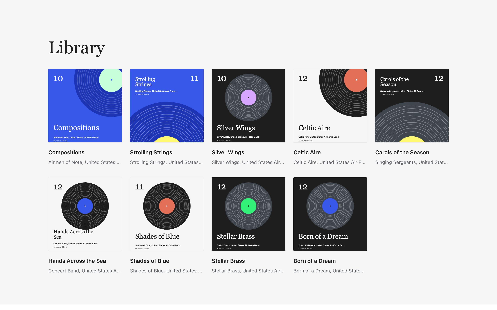

<strong>Your music, on your own site, played the way your listeners already love.</strong> A music player for WordPress.

<a href="https://next.riffpress.com/listen/app/"><strong>Try the live demo</strong></a> · <a href="https://riffpress.com/download/">Download</a> · <a href="https://riffpress.com/">riffpress.com</a>

- **Upload, and it's an album.** Put your music in the Media Library. Riff files it by album and artist. Nothing to sign up for, and nobody takes a cut.
- **Everything a streaming app does.** Now Playing, Up next, likes, playlists, search, the lock screen, AirPlay and Cast.
- **It keeps playing.** The music carries on as listeners move around your site, and they can install it as an app.

## Get started

1. Download [riff.zip](https://riffpress.com/download/) and upload it under **Plugins › Add New Plugin**.
2. Press **Create Listen page** on the Dashboard.

Riff needs WordPress 7.1 and PHP 8.1. There is nothing to configure. On WordPress 7.2 its fields also show in the Media Library's new views and forms.

## Build on it

Riff's [PHP, JavaScript, REST and CSS reference](https://riffpress.com/developers/) is the whole public API, and [Riff Lyrics](plugins/riff-lyrics/) is built on nothing else. To work on Riff itself, start with [CONTRIBUTING](.github/CONTRIBUTING.md).

## Licence

Riff is GPL-2.0-or-later.

Credits

- Roboto, Inter and EB Garamond are bundled under the SIL Open Font License.
- The logo is drawn from EB Garamond and Bravura, both under the SIL Open Font License ([site/brand/](site/brand/README.md)).
- The icons are Google's Material Icons, under the Apache License 2.0.
- The demo recordings are by the Airmen of Note, United States Air Force Band, and are public domain as U.S. Government works.

