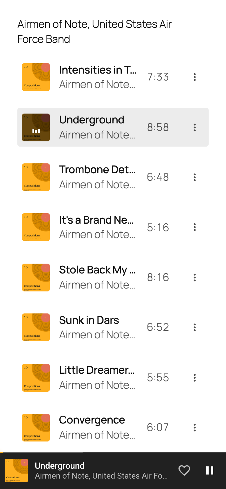
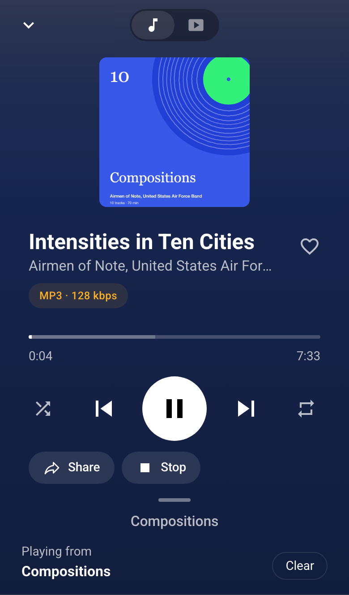
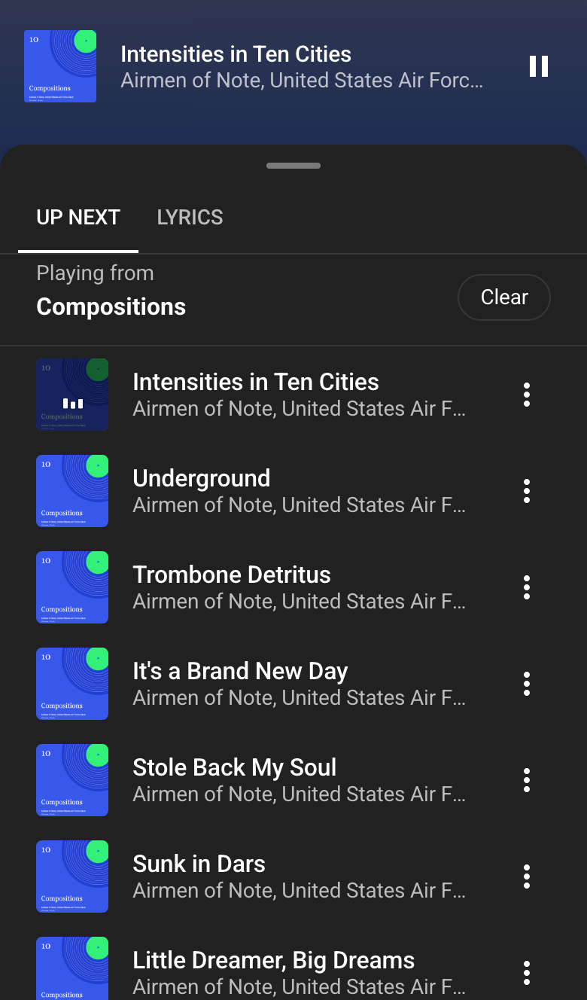

<p align="center"></p>

<p align="center"><strong>A music player for WordPress.</strong> Publish from the Media Library; your listeners get a streaming app.</p>

<p align="center">
<a href="https://github.com/RiffPress/RiffPress/releases?q=v4&expanded=true"></a>


<a href="LICENSE"></a>
</p>

<p align="center"><a href="https://riffpress.com/">Website</a> · <a href="https://riffpress.com/demo">Live demo</a> · <a href="https://riffpress.com/download/">Download</a> · <a href="https://github.com/RiffPress/RiffPress/releases?q=riff-desktop&expanded=true">Desktop app</a></p>

<p align="center"></p>

<p align="center">



</p>

## Get started

Upload the [zip](https://riffpress.com/download/) under **Plugins › Add New Plugin**, then press
**Create Listen page** on the Dashboard. Riff needs WordPress 7.0 and PHP 8.1.

[](https://riffpress.com/demo)

## Extending it

| Reference | |
| --- | --- |
| [PHP](https://riffpress.com/developers/php/) | Filters and actions, such as `riff_track` and `riff_can_play` |
| [JavaScript](https://riffpress.com/developers/javascript/) | `window.riff`: the queue, its events and filters |
| [REST API](https://riffpress.com/developers/rest/) | The `riff/v1` routes |
| [CSS](https://riffpress.com/developers/css/) | Custom properties for colours, fonts and spacing |

[Riff Lyrics](plugins/riff-lyrics/) is built only on this API.

## Contributing

```
npm install
npm run env:start   # WordPress at http://localhost:8890, the tests site at :8891
npm run seed:tests  # the demo albums on the tests site
npm run test:e2e
```

[.github/CONTRIBUTING.md](.github/CONTRIBUTING.md) covers setup, checks, pull requests and releases.

<details>
<summary>What is in this repository</summary>

| Path | What it is |
| --- | --- |
| `plugins/riff/` | The WordPress plugin. No build step: `assets/riff.js` and `assets/riff.css` are what ships. |
| `plugins/riff-lyrics/` | Riff Lyrics, the reference extension: a Lyrics tab in Now Playing. |
| `packages/desktop/` | The desktop app: a site's Listen library in an Electron window. |
| `packages/fixtures/` | Public-domain audio, video and artwork for demos and tests, and `seed.php`, which turns any folder of audio into a post. |
| `packages/wp-api-coverage/` | Lists the WordPress APIs a plugin uses and the ones it doesn't yet. |
| `apps/ios/` | Reserved for the native app. |
| `site/` | [riffpress.com](https://riffpress.com/), published with GitHub Pages. |
| `blueprint.json` | The Playground demo: installs the plugin, uploads the fixtures, seeds a post. |

</details>

<details>
<summary>More commands</summary>

```
npm run seed:tests -- wp-content/riff/path/to/your/music   # any folder of audio, as a post
npm run lint
npm run test:php
npm run desktop     # the desktop app from source, against the development site
```

The repository root is mounted in the containers at `wp-content/riff`, which is why seed paths start
there, and `.wp-env.override.json` moves the ports when another wp-env holds them. For the demo
built from `main`, open the `preview-main` blueprint:
`https://playground.wordpress.net/?mode=seamless&blueprint-url=https://raw.githubusercontent.com/RiffPress/RiffPress/preview-main/blueprint.json`

</details>

<details>
<summary>Docs in this repository</summary>

| File | What it covers |
| --- | --- |
| [PRODUCT.md](PRODUCT.md) | Who Riff is for, what it does, and what is out of scope. |
| [DESIGN.md](DESIGN.md) | How the player and the Listen block look and behave. |
| [docs/player.md](docs/player.md) | How the player works, for anyone changing it. |
| [docs/native.md](docs/native.md) | What Riff uses from WordPress as is, what it adds, and why. |
| [docs/hooks.md](docs/hooks.md), [docs/javascript.md](docs/javascript.md) | The hooks and `window.riff`, generated from the code. |
| [docs/iphone-checklist.md](docs/iphone-checklist.md) | What to check on a real iPhone before a release. |
| [.github/SUPPORT.md](.github/SUPPORT.md), [SECURITY.md](SECURITY.md) | Supported versions, the API promise, and reporting a vulnerability. |

</details>

## Licence

- Riff is GPL-2.0-or-later.
- Roboto, Inter and EB Garamond are bundled under the SIL Open Font License.
- The logo is drawn from EB Garamond and Bravura, both under the SIL Open Font License
  ([site/brand/](site/brand/README.md)).
- The icons are Google's Material Icons, under the Apache License 2.0.
- The demo recordings are by the Airmen of Note, United States Air Force Band, and are public domain
  as U.S. Government works.
