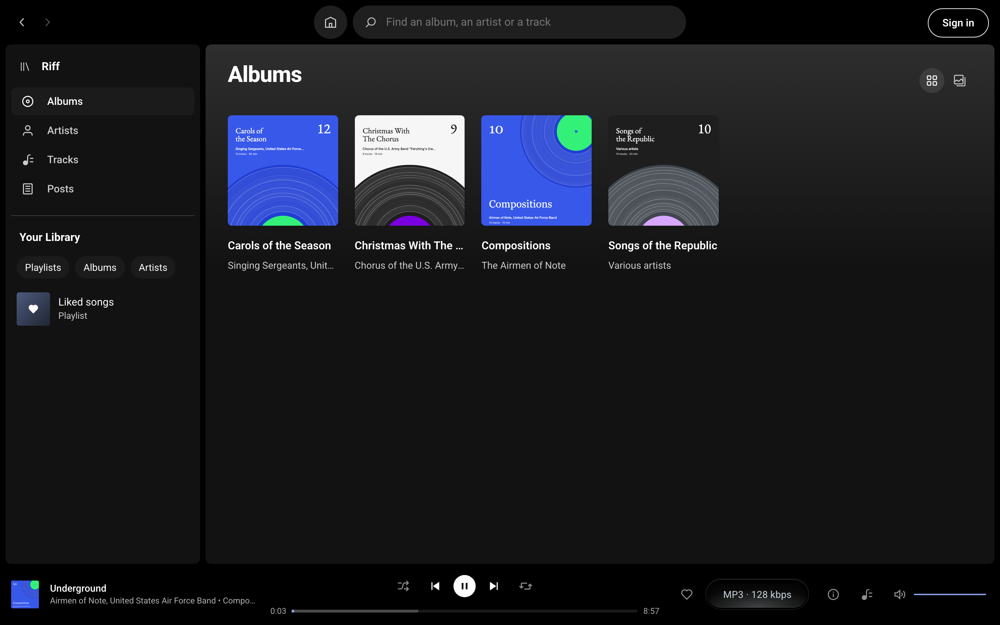

# Make an album

On a Riff site an album is the tracks whose files name the same album. There is no album to create: upload the tracks, as [Put your music in the Media Library](media-library.md) shows, and the album is on the Listen page, with a page of its own, ready to play or shuffle.

## Get the album right

1. Go to Media, then Library, and click a track.
2. Check its Album and Artist. Every track of one album needs the same album name, and, for a record by several artists, the same album artist in its tags.
3. Save. Riff files the track again at once.

The album's tracks play in their track numbers' order. The album's page names its artist and has More by that artist below.

Albums and Artists are also under the Media menu, where you can see how many tracks each holds. An artist's edit screen there has an Image field, for the picture at the top of their page; without one, their newest album's cover is used.

## Give it a cover

An album wears the artwork of the track that was uploaded first, which may not be track 1. Give every track of the album the same Artwork in the Media Library, or keep the cover the files came with, which WordPress takes from their tags when you upload them. Without either, it wears the featured image of the post the track was uploaded to.

With no picture at all, Riff draws one: a record with one groove per track, each groove as long as the track.

## Write about it

An album's page lists its tracks. To write about the record as well, give it a post, as [Play music in a post](post.md) shows; the post is listed under Posts on the Listen page, with its featured image as its cover. Riff makes one, as a draft, for each folder of tracks in a zip you upload.

## Under the hood

- An album is a term in the `riff_album` taxonomy on attachments, keyed by its name and album artist, and an artist one in `riff_artist`. The Listen page reads them from [`/riff/v1/albums`](https://source.riffpress.com/rest/#riff-v1-albums) and [`/riff/v1/artists`](https://source.riffpress.com/rest/#riff-v1-artists), and an album's tracks from [`/riff/v1/tracks`](https://source.riffpress.com/rest/#riff-v1-tracks). Each counts only the tracks the visitor may see.
- A track's album, artist, year and cover are in [the track schema](https://source.riffpress.com/php/#track-schema). The drawn cover is added in the [`riff_track`](../hooks.md#riff_track) filter, so a plugin's own filter can replace it.
- The `riff/track` [Block Bindings](https://source.riffpress.com/php/#block-bindings) source shows a track's title, artist, album, year, length, quality or cover in a Heading, Paragraph or Image block, with no Riff block on the page.
