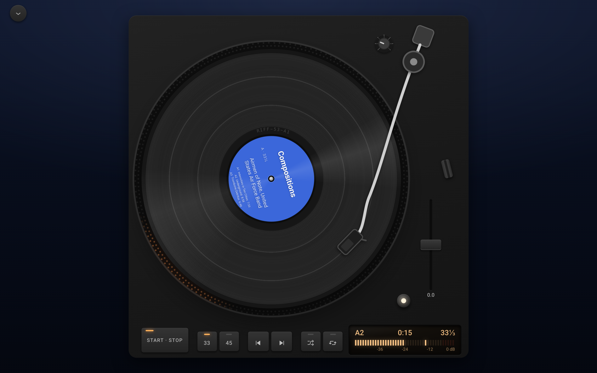

# Install the app

Every Listen page is also an app. Add `app/` to its address, for example `/listen/app/`, and the same library opens as a player on its own, in Riff's dark look and without your theme. A listener's browser can install that address, so your music opens from their dock or Home Screen like any other app. There is no app store and nothing to build.

## Try it

1. Open your Listen page and add `app/` to its address.
2. Visit it a second time. From a listener's second visit, the sidebar has a card that says Get the app, with your site's name in it.
3. In Chrome or Edge, press Install and the browser asks to install it. In Safari, the card says how instead: on a Mac, choose File, then Add to Dock; on an iPhone, tap Share, then Add to Home Screen.

Firefox has no way to install a site, so it shows no card. Once the app is installed, or the card is closed, it stays away.

The installed app is named after your site, with your Site Icon as its icon. Set both under Settings, then General: Site Title and Site Icon. Without an icon, it wears Riff's.

## Open it at the site's address

To make the app your home page, go to Settings, then Riff, and tick Open the player at the site's address under Listen app. The home page is then the Listen page's app, its `app/` address leads there, and an installed app opens there. The Listen page itself and your other pages stay as they are.

## What it does once installed

The app plays in the background with the screen locked, and takes the lock screen's controls, headphones' buttons and a computer's media keys. AirPlay and Chromecast show up when a speaker or TV is in reach. It needs the network to play, as the site does: Riff keeps no copy of the music for offline listening.

## Under the hood

- The app's manifest is served at `app/manifest/`, built from the site's title, tagline and Site Icon. [`riff_app_manifest`](../hooks.md#riff_app_manifest) changes its name, colours or icons.
- The setting is the `riff_app_at_root` option, and the [`riff_app_at_root`](../hooks.md#riff_app_at_root) filter sets it from code, for a host that gives each site its own player.
- The app's page colours are custom properties on `.riff-standalone`, such as `--riff-standalone-bg`, listed under [The Listen app](https://source.riffpress.com/css/#listen-app).
- In the browser it uses [Media Session](https://source.riffpress.com/web/#media-session) for the lock screen and media keys, and [Remote Playback](https://source.riffpress.com/web/#remote-playback) for casting. Chrome and Edge's install prompt is the `beforeinstallprompt` event, and the card counts visits in [Web Storage](https://source.riffpress.com/web/#web-storage). Each is used only where the browser has it.
