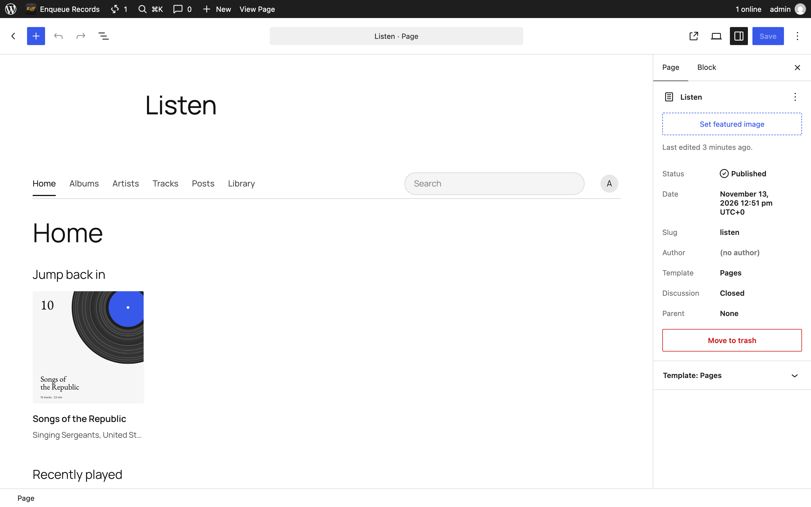
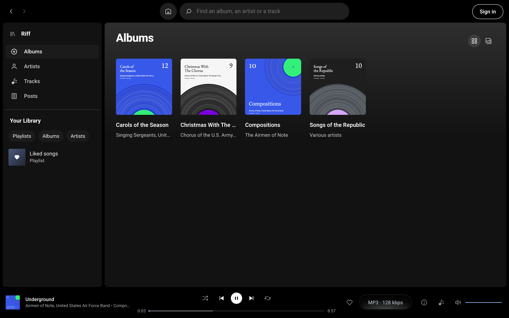

# Set up the Listen page

The Listen page is where a site's music lives: every album as a cover, pages for each album and artist, a list of every track, the posts with music in them, Your Library, and one search box. The music keeps playing while a visitor moves around it.

## Make it

After you activate Riff, the Dashboard shows a notice that starts "Riff is ready to play your music." Press Create Listen page. Riff publishes a page titled Listen, at `/listen/`, holding the Riff block.

To make it yourself:

1. Go to Pages, then Add Page, and give it a title.
2. Click the empty line, type `/riff` and choose the Riff block.
3. Press Publish.

A page holds one Riff block. Anywhere blocks are not an option, the `[riff]` shortcode shows the same library, though without the block's own colour and type settings.

## Give it the whole screen

On a block theme, open the page's Template setting and choose Listen. That template is the Riff block and nothing else, with no header or footer, so the whole page is the player.

To make it the site's front page, go to Settings, then Reading, choose A static page, and pick it as the homepage.

## Make it look like your site

The Riff block takes its colours and fonts from your theme. In the Site Editor, Styles, then Blocks, then Riff changes them for every Riff block, and the block's own settings in the sidebar change them for one page. Its colours, type, spacing, border and shadow can all be set there.

The player bar at the bottom of the screen keeps Riff's own look everywhere.

## What visitors can open

Each part of the Listen page has an address of its own, so a visitor can share or bookmark it: Albums, Artists, Tracks, Posts, Library and Search, one album, one artist, one playlist and one post. The search box works before any script loads.

A heart on every track, album and artist fills Your Library. A visitor's likes stay in their own browser; a listener who signs in keeps them on their account, as [Let listeners sign in](sign-in.md) explains.

## Under the hood

- The block is `riff/app`, with one attribute, `align`, which is `full` unless you change it. [The Listen block](https://source.riffpress.com/php/#the-listen-block) and [the `[riff]` shortcode](https://source.riffpress.com/php/#shortcode) are in the PHP reference.
- The block's colours, fonts and the bar's look are custom properties, listed under [The Listen block](https://source.riffpress.com/css/#listen-block) in the CSS reference.
- The library is read from [`/riff/v1/library`](https://source.riffpress.com/rest/#riff-v1-library), [`/riff/v1/albums`](https://source.riffpress.com/rest/#riff-v1-albums), [`/riff/v1/artists`](https://source.riffpress.com/rest/#riff-v1-artists) and [`/riff/v1/tracks`](https://source.riffpress.com/rest/#riff-v1-tracks).
- [`riff_app_views`](../hooks.md#riff_app_views) adds a view of a plugin's own to the Listen page's sidebar, and [`riff_add_music_url`](../hooks.md#riff_add_music_url) changes where Add music in its account menu goes. [`riff_enabled`](../hooks.md#riff_enabled) turns the player, and the block with it, off for a request.
- The search box is a plain `GET` form, and every view is a query on the page's address, such as `?riff_view=albums` or `?riff_album=12`.
