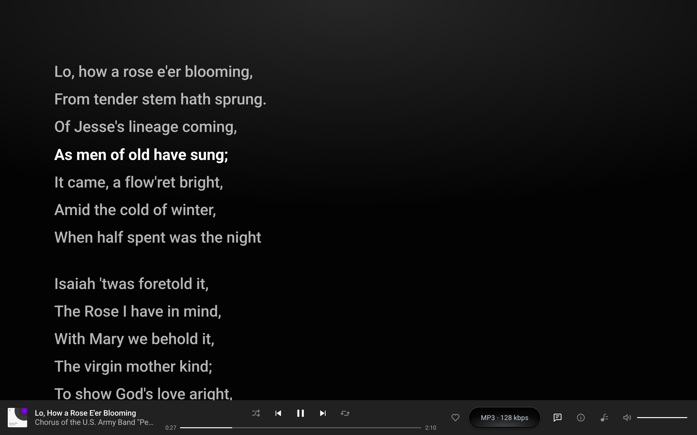
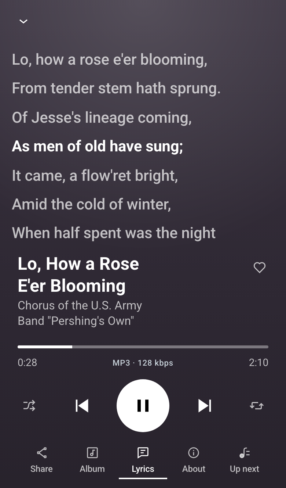

# Add lyrics

Riff Lyrics comes with Riff and is on unless you turn it off. It gives Now Playing a Lyrics view: plain words for a song, or words timed to the music, where the line being sung stands out and a tap on a line plays from there.

## From the files

When you upload a song, the lyrics in its tags are read with the rest of its details, in MP3, FLAC, Ogg and M4A files alike, and Riff Lyrics also reads an MP3's timed lyrics. A track whose file has lyrics needs nothing more.

## Type them in

1. Go to Media, then Library, and click a song.
2. Type or paste the words into its Lyrics field.
3. Save.

The field takes plain text, kept line for line, or timed lyrics in LRC, with a `[mm:ss.xx]` stamp before each line, or WebVTT, starting with `WEBVTT`. In LRC, `<mm:ss.xx>` stamps inside a line time each word, and `[offset:+250]` shows every line 250 milliseconds sooner. A blank line between timed lines is a pause. Clear the field and the track has no lyrics.

## Where listeners see them

A track with lyrics gets a Lyrics button in the player bar on a wide screen, and a Lyrics chip in Now Playing on a phone.

Only tracks with lyrics show the button, and only to visitors who may read the track.

## Turn it off

Go to Settings, then Riff, and untick Riff Lyrics under Extensions. On a network, Network Admin, then Settings, then Riff, can set it for every site, as [Run Riff for a client or a network](network.md) explains.

## Under the hood

- The words are kept where WordPress keeps an MP3's lyrics, `unsynchronised_lyric` in the attachment's metadata, and are in `wp/v2/media` as `media_details.unsynchronised_lyric` and the plugin's own `riff_lyrics` field.
- Riff Lyrics is built only on Riff's public surface: the view is registered on [`riff_register`](../hooks.md#riff_register) with [`riff_register_view()`](https://source.riffpress.com/php/#riff_register_view), [`riff_track`](../hooks.md#riff_track) marks the tracks that have lyrics, and in the browser [`window.riff.view()`](https://source.riffpress.com/javascript/#method-view) draws it and [`window.riff.seek()`](https://source.riffpress.com/javascript/#method-seek) plays from a tapped line. [Extensions](../extensions.md) explains how it ships inside Riff.
- Its code is in [plugins/riff-lyrics](../../plugins/riff-lyrics/).
