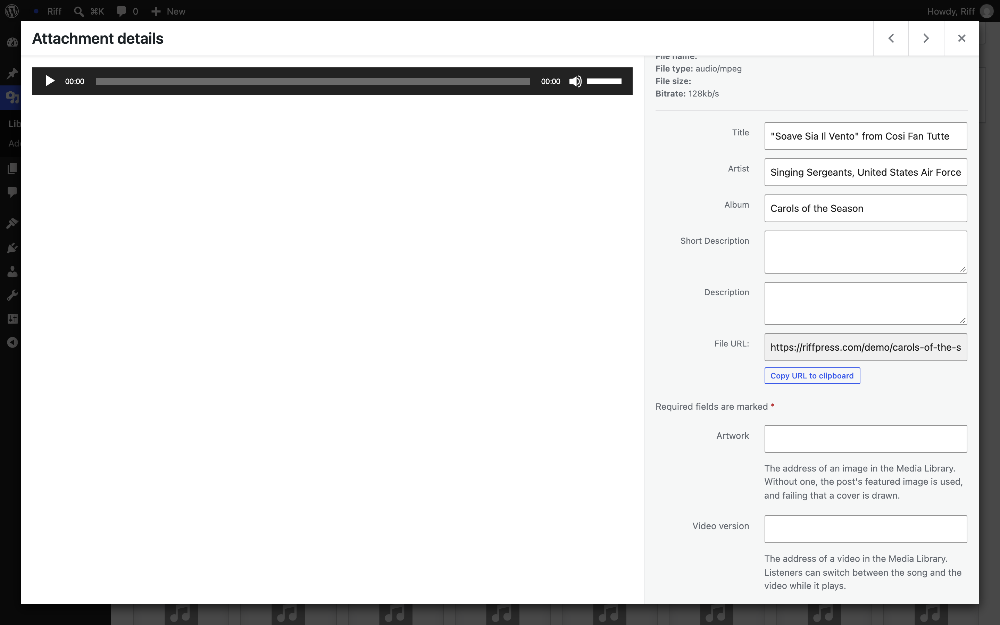

# Put your music in the Media Library

Riff plays what is in your Media Library. Upload a track and it is on your Listen page, filed under its album and artist, with nothing else to do. [Add your music](https://source.riffpress.com/add-music/) walks through a whole first album, from installing WordPress on.

## Upload

1. Go to Media, then Add New Media File.
2. Drag in an album's tracks, all at once. MP3, M4A, FLAC, WAV and OGG all work, and so do MP4 and WebM for video.
3. Open your Listen page. The album is there, ready to play.

Riff plays the file you uploaded at its own quality and converts nothing. Each track shows its quality as WordPress read it, such as MP3 · 320 kbps or FLAC · 24-bit 96 kHz.

## The details come from the files

WordPress reads the title, artist, album, year and cover from the tags inside each file, the same tags your music app uses, and Riff files each track under its album and artist from them. Two albums with the same name by different artists stay apart.

If a file has no tags, or the wrong ones, go to Media, then Library, click the file and fix them there. Riff files it again as soon as you save.

## Riff's fields

The same screen has fields Riff adds to an audio file:

- Artwork, a cover for the track. Without one, the post's featured image is used, and failing that Riff draws a cover.
- Video version, a video in the library for a song that has one, such as a live take. Listeners switch between the song and the video while it plays, without losing their place.
- Streaming version, a smaller copy of the song, such as an MP3 of a lossless file. Listeners stream it, and the file you uploaded stays the original. Where the server has ffmpeg, `wp riff transcode` makes one, an MP3 at 192 kbps unless told otherwise, for every song that has none and is lossless or well above that rate.
- Protected, which keeps the file itself private: Riff moves it into a folder of its own and sends it only to visitors who can read a post that has it. Apache and LiteSpeed keep that folder closed by themselves; Nginx ignores the rule Riff leaves there, so the field and Tools, then Site Health, say when the server sends that folder to anyone, and Site Health gives the line to add to the server's configuration.

A video file has Artwork and Protected too, and a Captions field in place of the two versions, for a WebVTT file in the library, which listeners can turn on in Now Playing.

## Many albums at once

Upload a zip of an album, or of several, to the Media Library. Riff unpacks it in the background and makes a draft post for each folder in it that holds audio, ready for you to publish. A cover, folder or front image beside the tracks becomes the artwork. With WP-CLI, `wp riff import` with the path to a folder or a zip does the same and publishes the posts; add `--dry-run` to see what it would do first. Run either again and it skips what it already imported.

## Under the hood

- Every audio and video item in `wp/v2/media` carries the read-only `riff_track` field, described under [The track on media](https://source.riffpress.com/rest/#media). Its shape is [the track schema](https://source.riffpress.com/php/#track-schema), after the [`riff_track`](../hooks.md#riff_track) filter.
- Albums and artists are two taxonomies on attachments, `riff_album` and `riff_artist`, kept by Riff from the tags each time WordPress saves a file's metadata. An album is keyed by its name and its album artist, the `band` tag.
- The fields are saved as attachment meta, and the artwork as the attachment's featured image. On WordPress 7.2, Artist, Album, Video version, Streaming version and Protected are in the Media Library's field API too.
- A protected file is served through WordPress. [`riff_protected_url`](../hooks.md#riff_protected_url), [`riff_protected_send`](../hooks.md#riff_protected_send) and [`riff_protect_storage`](../hooks.md#riff_protect_storage) let a plugin that keeps files elsewhere take part.
- The zip import runs on WP-Cron, as the person who uploaded it.
