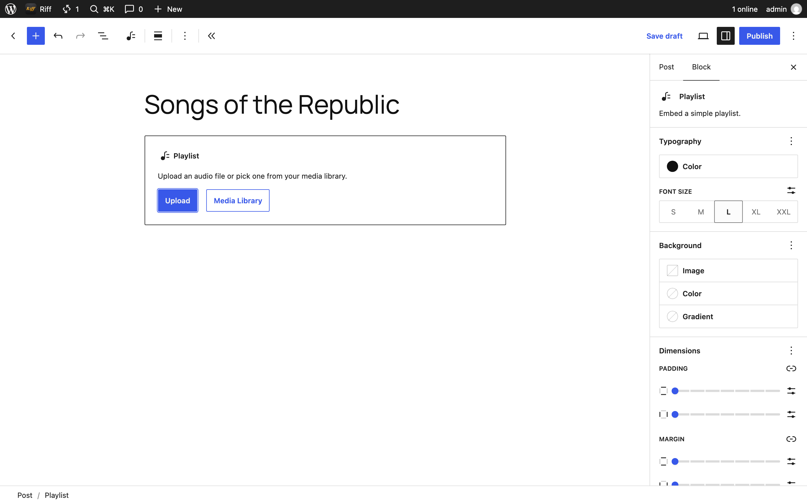
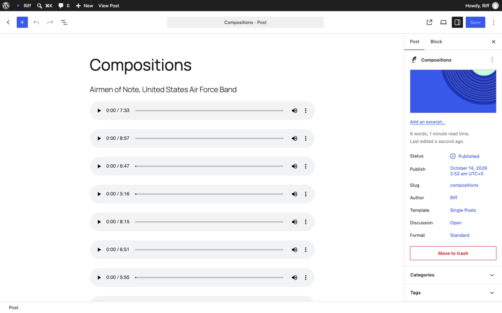
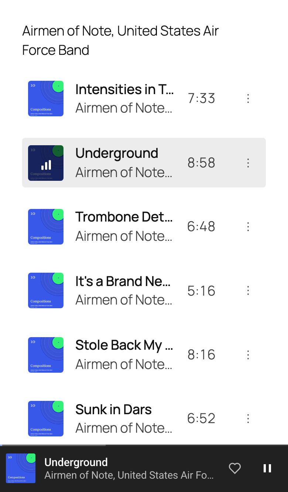

# Play music in a post

Riff needs no block of its own in a post. It plays WordPress's Audio, Video and Playlist blocks: each track gets a row with a play button, and pressing one starts Riff's player bar at the bottom of the screen, which keeps playing while the reader scrolls or locks their phone. Follow a link to another page and the track picks up where it was, though some browsers, Safari among them, wait for a press of play.

## Put an album in a post

1. Go to Posts, then Add Post, and type the album's name as the title.
2. Click the empty line below it, type `/playlist` and press Enter.
3. Choose the tracks from the Media Library, or upload them here. Drag them into order.
4. Press Set featured image in the sidebar to give the post a cover, then Publish.

An Audio block for each track works too: type `/audio` instead. A Video block plays in the same player as the songs around it.

## What readers get

The queue is every track on the page, in order, starting from the one pressed. Tap the bar for Now Playing, with the artwork, the controls and what plays next.

Riff doesn't change the blocks' own markup, so the post still plays with the browser's own player if Riff's script doesn't load, and the post reads the same in its feed.

Make the post private, a draft or password protected, and visitors no longer find it under Posts on the Listen page. The tracks uploaded to it, with Upload in step 3, leave the Listen page with it; a track chosen from the Media Library belongs to the post it was first uploaded to, and stays wherever that post is.

## The Riff block in a post

The Riff block is the Listen page, the whole library, and a page holds one. It isn't needed for a post's own tracks, which play from their blocks. [Set up the Listen page](listen-page.md) is about that block.

## Under the hood

- Riff reads `core/audio`, `core/video` and `core/playlist` blocks, at any depth, and adds a `data-riff-track` attribute to each track's figure or list item, holding the track as [the track schema](https://source.riffpress.com/track/) has it, after the [`riff_track`](../hooks.md#riff_track) filter.
- [`riff_can_play`](../hooks.md#riff_can_play) decides whether a visitor may play a track, and [`riff_unlock_url`](../hooks.md#riff_unlock_url) where a locked one leads, for a membership or store plugin.
- In the browser, [`window.riff.play()`](https://source.riffpress.com/javascript/#method-play) starts a queue of a script's own, and the [`riff.queue`](../hooks.md#riffqueue) filter changes the one Riff builds from the page.
- On a block theme, [`riff_client_navigation`](../hooks.md#riff_client_navigation) turns on following a link without leaving the page, so what plays carries on.
